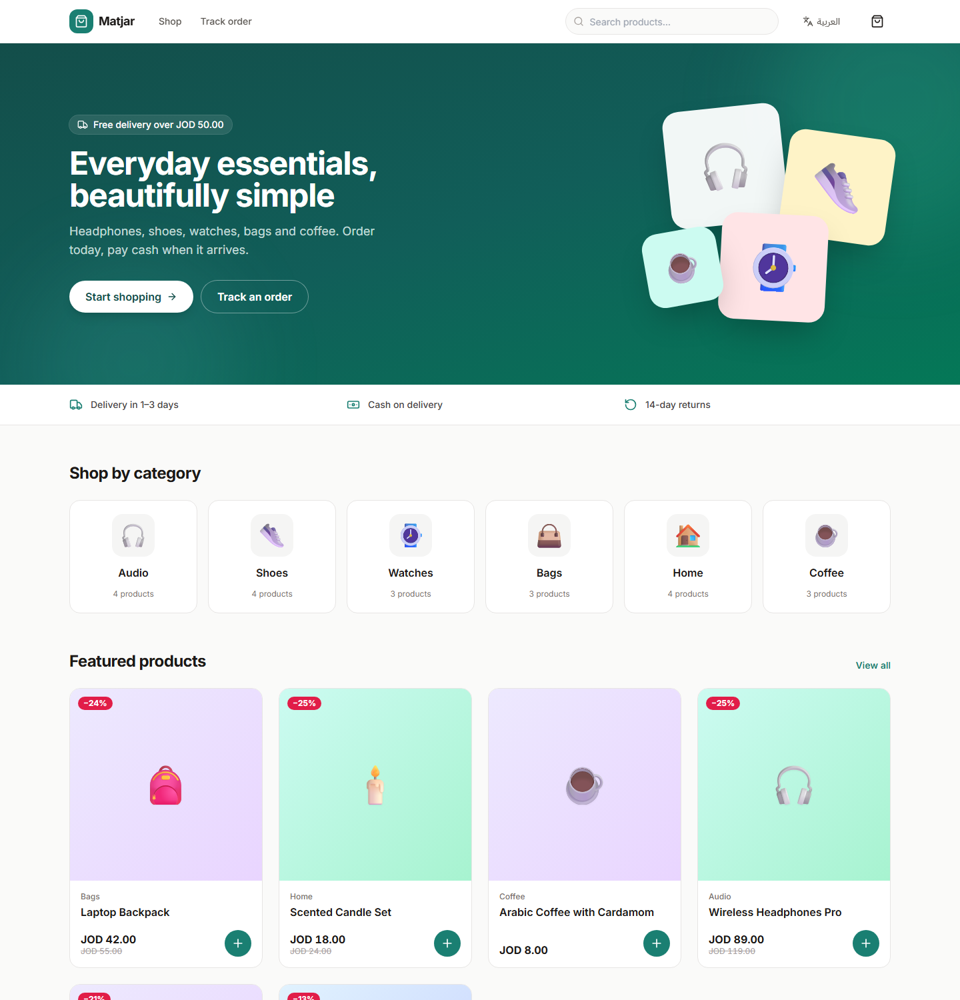
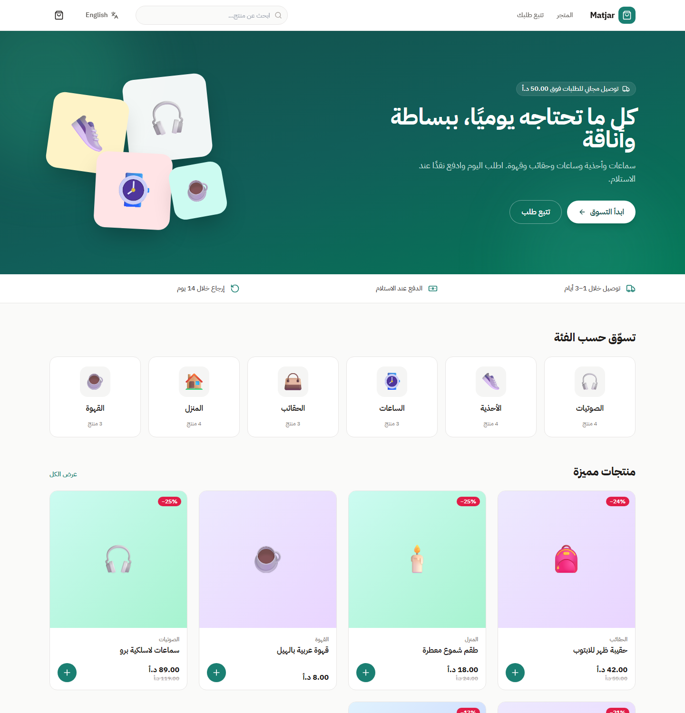
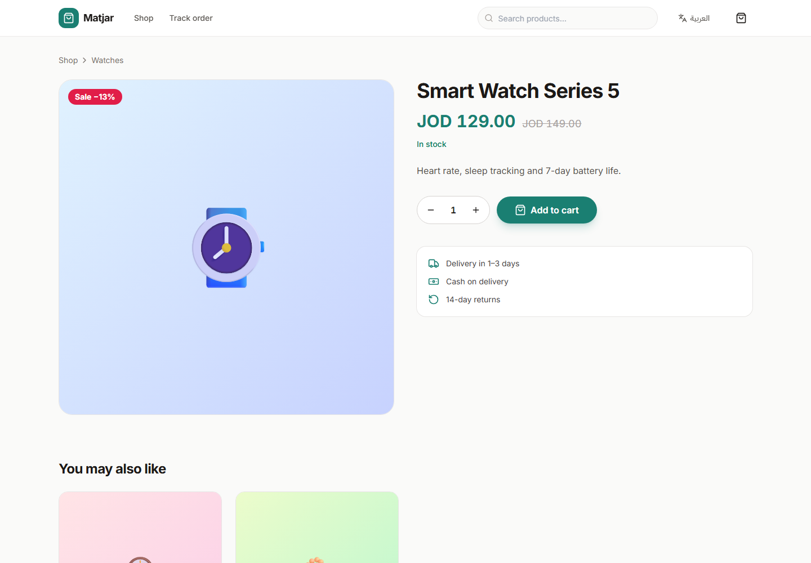

<div align="center">

# Matjar · متجر

**Bilingual (Arabic / English) e-commerce store with a Filament admin panel.**

[](https://github.com/deema-khaled/matjar/actions/workflows/tests.yml)
[](https://github.com/deema-khaled/matjar/actions/workflows/lint.yml)




</div>

## What it does

Shoppers browse, search and filter products, add them to a cart, and check out as guests with **cash on delivery**. They can then track the order with its number and phone. The whole storefront switches between **Arabic (RTL)** and **English**. Store staff manage products, categories and orders in a **Filament** admin panel, with a sales dashboard.

| Arabic, right-to-left | Product page |
| --- | --- |
|  |  |

## Features

**Storefront (Vue 3 + Inertia)**
- Arabic / English with full **RTL layout**, an Arabic typeface, and localized prices (`JOD 42.00` / `42.00 د.أ`). Language is detected from the browser and remembered.
- Category pages, search across both languages, sort by price, and an "in stock only" filter.
- Product pages with sale badges, low-stock warnings and related products.
- Session cart with a free-delivery progress bar. Prices are always re-read from the database, so an old session can't keep an outdated price.
- Guest checkout (cash on delivery), an order confirmation page, and **order tracking** that needs both the order number and the phone.

**Admin (Filament 3)**
- Dashboard: monthly revenue vs last month, orders, items waiting to ship, low stock, a 30-day revenue chart, and latest orders.
- Products with English/Arabic tabs, image upload, price entered in JOD (stored in fils), stock, featured/visible toggles, and filters (category, low stock).
- Orders with status tabs, one-click "Mark processing → shipped → delivered", and cancel with **automatic restock**.
- Navigation badges for pending orders and low-stock products.

## Engineering highlights

- **No overselling.** `PlaceOrder` locks the product rows (`SELECT … FOR UPDATE`) inside a transaction, re-checks stock, then decrements it. If stock ran out after an item was added to the cart, the order is rejected cleanly.
- **Money as integers.** Prices are stored in fils (1 JOD = 1000 fils), so there are no floating-point rounding bugs.
- **Price snapshots.** Each order line keeps the name and price it was sold at, so later product edits don't change past orders.
- **Private tracking.** Receipts are tied to the session that placed the order. Tracking needs number + phone (compared by digits only), and requests are rate-limited.
- **One translation source.** `lang/{en,ar}/store.php` feeds both Laravel and the Vue `t()` helper.

## Tech stack

| Layer | Tools |
| --- | --- |
| Backend | Laravel 12, PHP 8.2+, Eloquent, Actions/Services |
| Admin | Filament 3 (resources, widgets, actions) |
| Frontend | Vue 3 + TypeScript, Inertia.js 2, Tailwind CSS |
| Data | MySQL 8.4 |
| Quality | Pest (34 tests), Laravel Pint, ESLint, Prettier |
| DevOps | Docker (PHP-FPM + Nginx), GitHub Actions (tests on SQLite **and** MySQL) |

## Quick start

### Option A: everything in Docker

```bash
git clone https://github.com/deema-khaled/matjar.git
cd matjar
cp .env.example .env
# Generate a key and paste it into APP_KEY in .env
docker run --rm php:8.4-cli php -r "echo 'base64:'.base64_encode(random_bytes(32)).PHP_EOL;"
docker compose --profile app up -d --build
```

Open **http://localhost:8001**. Demo data is seeded on first start.

### Option B: local development

Requires PHP 8.2+, Composer and Node 20+. MySQL runs in Docker.

```bash
composer install && npm install
cp .env.example .env && php artisan key:generate
docker compose up -d              # MySQL on port 3307
php artisan migrate --seed
php artisan storage:link
composer run dev                  # http://localhost:8081
```

### Demo access

| | |
| --- | --- |
| Store | `/` (add `?lang=ar` for Arabic) |
| Admin | `/admin` · `admin@matjar.test` / `password` |

## Tests

```bash
php artisan test
```

They cover the cart (stock caps, price changes, free delivery), checkout (stock decrement, out-of-stock race, validation), cancellation restock, order tracking privacy, Arabic/RTL rendering, admin access, and the Filament widgets and actions.

## Project structure

```
app/
├── Actions/PlaceOrder.php        transaction + row locks + stock checks
├── Services/Cart.php             session cart, totals, free-delivery rule
├── Support/Money.php             integer money formatting (EN/AR)
├── Filament/Resources/           Products, Categories, Orders
├── Filament/Widgets/             Stats, revenue chart, latest orders
└── Http/Middleware/SetLocale.php
lang/{en,ar}/                     storefront + status translations
resources/js/pages/store/         Home, Shop, Product, Cart, Checkout, OrderPlaced, Track
```

## License

MIT
